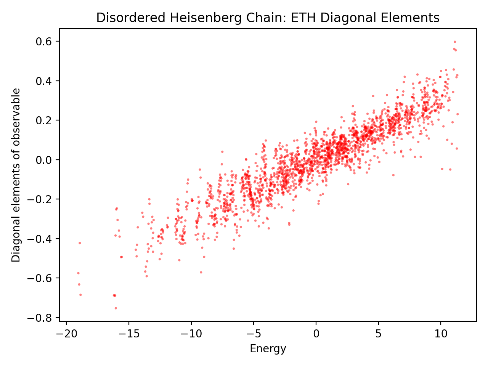

# ETH Spin Chain

A lightweight Python toolkit for exact-diagonalization studies of Eigenstate
Thermalization Hypothesis (ETH) matrix elements in finite spin-chain models.

The core module, `eth_spin_chain.py`, provides model-agnostic Pauli-string
Hamiltonian and observable tooling. `standard_models.py` adds ready-to-run
reference models used in the public examples.

## Representative Result



Diagonal matrix elements $\langle E_i|Z_0 Z_1|E_i\rangle$ versus energy for a
disordered Heisenberg chain with $L=11$ and periodic boundaries. Each point
represents one of the $2^{11}=2048$ energy eigenstates. The exchange couplings
in each direction are sampled uniformly from $[0.9, 1.1]$, and onsite fields
from $[-0.05, 0.05]$, using `seed=123`.

Reproduce this figure with `python3 examples/disordered_heisenberg_eth.py`
after installation. The script saves the plot to
`outputs/disordered_heisenberg_eth.png`.

## Run in Google Colab

[](https://colab.research.google.com/github/osamufukushima/ETH-spin-chain/blob/main/notebooks/demo_eth_models.ipynb)

Open the notebook using the button above, connect to a CPU runtime, and choose
**Runtime > Run all**. The setup cell installs this package and its dependencies
from the repository's `main` branch. The notebook then plots results for five
small spin-chain models; you can edit the model parameters and observables and
rerun the cells.

No local installation is required. The demos use $L=6$ or $L=8$ by default;
start with these sizes because dense exact diagonalization scales exponentially.

## Features

- Flexible Hamiltonian construction with arbitrary Pauli-string interaction
  terms via `InteractionTerm`
- Open and periodic boundary conditions (`"open"` or `"periodic"`)
- Coupling sampling helpers for weak disorder and reproducible random models
- Observable algebra (`multiply`, `commutator`, `commutes_with`)
- Nonlocal observable builders (`all_site_product_observable`,
  `shifted_product_observable`)
- Exact diagonalization with reusable eigensystems
- ETH diagnostics:
  - Full energy spectrum
  - Diagonal matrix elements $\langle E_i|O|E_i\rangle$
  - Off-diagonal statistics in an energy window
- Optional plotting helper for ETH diagonal scatter
- Regression tests for core model-building and ETH behavior

## Install

```bash
python3 -m venv .venv
source .venv/bin/activate
python3 -m pip install -e ".[dev]"
```

Runtime dependencies only:

```bash
python3 -m pip install -r requirements.txt
```

## Quick Start

```bash
git clone https://github.com/osamufukushima/ETH-spin-chain.git
cd ETH-spin-chain
python3 -m venv .venv
source .venv/bin/activate
python3 -m pip install -e ".[dev]"
python3 examples/disordered_heisenberg_eth.py
```

Expected result:

- terminal prints a few energies and diagonal matrix elements;
- a plot image is saved under `outputs/disordered_heisenberg_eth.png`.

## Data Structures

| Class | Purpose |
|---|---|
| `ObservableTerm(sites, ops, coeff)` | Single Pauli-string term in an observable |
| `ObservableSpec(terms)` | Observable as a sum of `ObservableTerm`s |
| `InteractionTerm(sites, ops, coeff)` | Single Pauli-string term in a Hamiltonian |
| `HamiltonianSpec(L, terms, boundary)` | Full Hamiltonian specification |
| `DiagonalizedHamiltonian` | Reusable Hamiltonian matrix, energies, eigenvectors |
| `EnergyWindow(center, width)` | Energy window for off-diagonal ETH statistics |
| `ETHResult` | Output container from `eth_elements(...)` |

`ops` uses Pauli characters from `{I, X, Y, Z}` with one character per site
index in `sites`.

## Quick Example

```python
from eth_spin_chain import (
    DiagonalizedHamiltonian,
    ObservableSpec,
    ObservableTerm,
    eth_elements,
)
from standard_models import disordered_heisenberg_chain

ham = disordered_heisenberg_chain(
    L=8,
    jx=(0.9, 1.1),
    jy=(0.9, 1.1),
    jz=(0.9, 1.1),
    hx=(-0.05, 0.05),
    hy=(-0.05, 0.05),
    hz=(-0.05, 0.05),
    seed=123,
)
observable = ObservableSpec([ObservableTerm(sites=[0], ops="Z")])

diagonalized = DiagonalizedHamiltonian.from_spec(ham)
result = eth_elements(diagonalized, observable)

print(result.energies[:5])
print(result.diagonal[:5].real)
```

## Core API Overview

Observable algebra:

```python
ObservableSpec.multiply(other, tol=1e-12) -> ObservableSpec
ObservableSpec.commutator(other, tol=1e-12) -> ObservableSpec
ObservableSpec.commutes_with(other, tol=1e-12) -> bool
```

Hamiltonian and observable helpers:

```python
sample_couplings(n_terms, j_min, j_max, rng=None, seed=None) -> np.ndarray
sample_interaction_terms(L, ops, j_min, j_max, boundary="periodic", rng=None, seed=None) -> list[InteractionTerm]
sampled_interaction_hamiltonian(L, ops, j_min, j_max, boundary="periodic", rng=None, seed=None) -> HamiltonianSpec
all_site_product_observable(L, ops, coeff=1.0) -> ObservableSpec
shifted_product_observable(L, ops, coeff=1.0, boundary="periodic", tol=1e-12) -> ObservableSpec
HamiltonianSpec.to_observable_spec() -> ObservableSpec
```

Numerics and ETH:

```python
build_hamiltonian(spec: HamiltonianSpec) -> np.ndarray
build_observable(L: int, obs: ObservableSpec) -> np.ndarray
eth_diagonal_elements(vectors: np.ndarray, observable: np.ndarray) -> np.ndarray
energy_window_indices(energies: np.ndarray, window: EnergyWindow) -> np.ndarray
DiagonalizedHamiltonian.from_spec(spec: HamiltonianSpec) -> DiagonalizedHamiltonian
eth_elements(hamiltonian, observable_spec, window=None, return_full_window_matrix=False, max_window_dim=256) -> ETHResult
check_energy_degeneracy(energy_data, atol=1e-10, rtol=1e-12) -> tuple[bool, list[np.ndarray]]
```

Plotting helper:

```python
plot_eth_diagonal_scatter(result, ax=None, figsize=(6.4, 4.8), marker_size=5.0, alpha=0.5, color="red", marker="o")
```

## Standard Models Included

- Transverse-field Ising chain
- XXZ chain
- Disordered Heisenberg chain
- Z2 x Z2 projective XYZ chain (Eq. (5.14)-inspired)
- Random Pauli-string Hamiltonian

For `disordered_heisenberg_chain`, weak disorder is configurable for all
nearest-neighbor channels (`XX`, `YY`, `ZZ`) and all onsite field directions
(`X`, `Y`, `Z`) using either fixed values (`float`) or sampled ranges
(`(min, max)`).

Backward-compatibility note: if `hz` is omitted, Z-field disorder falls back to
the legacy `field_strength` behavior.

See `docs/demo_hamiltonians.md` for equations, parameter definitions, and
explicit constructor signatures.

See `docs/model_symmetries.md` for a concise symmetry guide for each
demonstration Hamiltonian.

## Examples

Run example scripts from the repository root:

```bash
python3 examples/disordered_heisenberg_eth.py
python3 examples/z2z2_projective_xyz_eth.py
python3 examples/xxz_chain_eth.py
python3 examples/transverse_field_ising_eth.py
python3 examples/random_pauli_hamiltonian.py
```

Plotting examples save figures under `outputs/`.

`EnergyWindow` is only needed when computing off-diagonal statistics inside an
energy window. The example plots use the full-spectrum diagonal elements and do
not require an energy window.

## Verification

```bash
python3 -m pytest -v
python3 -m compileall -q eth_spin_chain.py standard_models.py examples
```

## Scope and Limitations

This toolkit uses dense exact diagonalization. The Hilbert-space dimension is
$2^L$, so runtime and memory scale exponentially with system size. Public demos
therefore use small systems such as `L=8` or `L=10`.

The repository is intentionally model-agnostic. Project-specific Hamiltonians
can be built downstream using the same Pauli-string interface.

## Project Layout

| Path | Purpose |
|---|---|
| `eth_spin_chain.py` | Core Pauli-string Hamiltonians, observables, diagonalization, ETH diagnostics, plotting |
| `standard_models.py` | Standard demonstration Hamiltonians built on top of `eth_spin_chain.py` |
| `examples/` | Runnable demo scripts |
| `docs/demo_hamiltonians.md` | LaTeX summary of demo Hamiltonians and parameter usage |
| `docs/model_symmetries.md` | Symmetry summary for each demo Hamiltonian |
| `docs/figures/` | Representative figures displayed in this README |
| `tests/` | Regression tests |
| `notebooks/` | Public notebook workspace and notebook hygiene notes |

## Author

Osamu Fukushima  
[Website](https://osamufukushima.github.io/web/)
